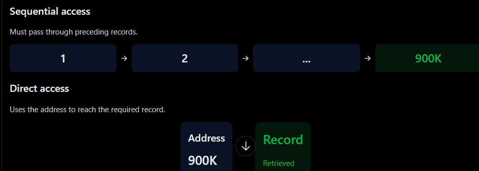
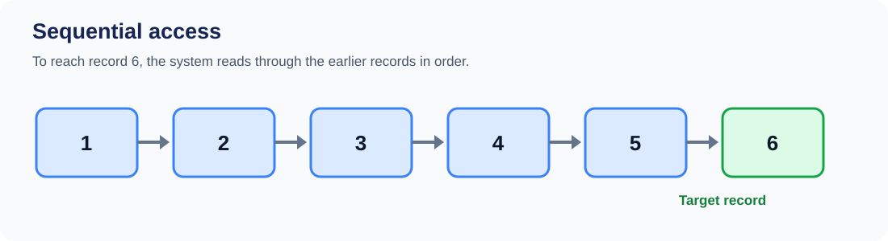
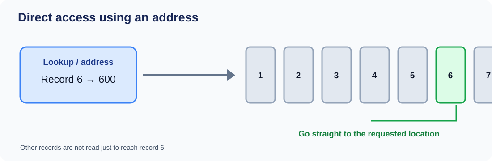

# Sequential Access vs Direct Access — Verbatim Chat Transcript

This file keeps the visible text of the conversation in its original order and wording. Formatting has been represented in Markdown so it can be read as a `README.md`. Images that were available as files are included in `images/` and embedded below.

---

## 1. User

in direct access and sequential access what i want to ask is that in direct  access we can access without a sequence so what it sacrifices or removes from sequential access to be direct access what is that difference

## 2. Assistant

Your understanding is correct! In **direct access, we can access any record directly without reading the previous records one by one.**

But your question is interesting: **What do we sacrifice or remove from sequential access to make it direct access?**

Let's understand it.

### 1. Sequential access

In sequential access, data is stored and accessed in a particular order.

For example, imagine a cassette tape. If you want to listen to song number 5, you have to pass through songs 1, 2, 3 and 4 first.

*Image displayed in the original chat: cassette tape audio player with cassette tape illustration.*

### 2. Direct access

In direct access, you can jump directly to the record you want without going through the previous records.

For example, imagine a music player where you can click directly on song number 5.

*Image displayed in the original chat: digital music player playlist selecting an individual track.*

### 3. So, what is sacrificed?

Here is the actual difference:

| Sequential access | Direct access |
|---|---|
| Records are accessed in order. | Records can be accessed in any order. |
| No need to calculate the record's location. | Requires locating or calculating the record's position. |
| Simple storage and access mechanism. | More complex storage and access mechanism. |
| Efficient for reading data continuously. | Efficient for retrieving specific records. |

**The most important point:**

Direct access does not exactly remove something from sequential access. Instead, it removes the requirement of following the sequence when retrieving data.

Think of it this way:

- Sequential access: You must follow the queue.
- Direct access: You can go directly to the person you want.

**One thing to remember for exams:**

Direct access sacrifices neither the data nor the sequence of records. It sacrifices the restriction of having to access records in sequence and requires an additional mechanism to locate the desired record.

That's the fundamental concept!

## 3. User

why are you automatically assuming i need it for exam and also how is it possible i can anything without a sequence

## 4. Assistant

You're right to question both things. I shouldn't have assumed you were asking for an exam. Let's focus on understanding the actual concept.

Your second question is much more interesting:

**How can we access something without a sequence? Doesn't everything have to be somewhere in an order?**

The answer is: **Direct access doesn't mean there is no sequence in the storage. It means we don't have to follow that sequence to retrieve something.**

### Let's understand with a physical example.

Imagine a library with 1,000 books.

*Image displayed in the original chat: library bookshelves with rows of books.*

Suppose you want book number 800.

**Sequential access:**

Imagine the books are arranged in a line, and you are allowed to move only from one book to the next.

To reach book 800, you must pass books 1 through 799.

**Direct access:**

Now imagine every book has an address:

- Book 1 → Shelf A, Position 1
- Book 2 → Shelf A, Position 2
- Book 800 → Shelf H, Position 20

You look up the address of book 800 and go straight to it.

You didn't need to visit books 1 through 799.

### But how is this technically possible?

This is where the important concept comes in.

In direct access, the system has a way to determine the location of the required data.

For example, in a disk:

1. Data is stored in different addressable locations.
2. Each location has an address.
3. When you request particular data, the system identifies its address.
4. The disk accesses that location without reading all the data before it.

*Image displayed in the original chat: hard disk platter with tracks and sectors diagram.*

### Now, let's answer your original question more precisely.

What changes between sequential and direct access?

It is not necessarily the order in which data is stored.

It is the **method of reaching the data**.

- Sequential access: To reach data B, you must go through A first.
- Direct access: You can reach B using its address, without first accessing A.

And here's a subtle but important distinction:

**Direct access does not mean zero movement or zero steps.** The hardware may still need to move its read/write head or perform other operations. It simply doesn't need to read every preceding record.

That's the real difference.

## 5. User

so for example in a database i am storing vowel and alphabets so if i ask it to access i so how will it know to get it from vowel it would have to scaneach and every characters in both to reach to conclusion of vowels

## 6. Assistant

Aha! Now you're getting to the actual mechanism behind direct access. Your doubt is absolutely valid.

You're asking:

"If I store vowels and alphabets in a database, and I ask for the letter 'i', how does the computer know where 'i' is? Doesn't it have to scan all the characters to find it?"

**The answer is: Not necessarily. It depends on how the data is organized and how the database searches it.**

Let's take your example.

### 1. Suppose you store data like this

| Position | Character | Category |
|---|---|---|
| 1 | A | Vowel |
| 2 | B | Consonant |
| 3 | C | Consonant |
| 4 | D | Consonant |
| 5 | E | Vowel |
| 6 | F | Consonant |
| 7 | I | Vowel |

Now you ask the database to find `I`.

If the database has no index, it might check:

A → Is it I? No.

B → Is it I? No.

C → Is it I? No.

And so on.

This is called a **sequential scan**.

### 2. How can direct access solve this?

The database can maintain an index.

Imagine an index like this:

**Index (lookup table)**

| Character | Storage address |
|---|---:|
| A | 100 |
| B | 200 |
| C | 300 |
| D | 400 |
| E | 500 |
| I | 700 |

**Requested character: I**

**Address 700**

Go directly to the stored record.

When you request `I`:

1. The database looks up I in its index.
2. The index tells it that I is stored at address 700.
3. The database retrieves the record from address 700.

It doesn't have to scan every character in the actual data.

### 3. But wait, doesn't the index itself need searching?

Excellent question!

Yes, it does need to locate I in the index. But the index can itself be organized efficiently, for example using a B-tree.

A B-tree doesn't require checking every entry one by one. It eliminates large portions of the search space at each step.

For example, instead of checking 1,000 records individually, it can narrow down the location through a few comparisons.

---

### The big realization

There are actually two different things happening:

- **Finding where the data is:** Using an index or address.
- **Accessing the data:** Retrieving it from that location.

Direct access is possible because we have a way to identify the location of the requested data without reading all the preceding records.

And one final distinction: direct access and indexing are related ideas, but they aren't identical. A disk can support direct access through physical or logical addresses even without a database index. An index is one way a database makes searching efficient.

## 7. User

so what you mean is that in sequential it doesnt search it checks sequence wise but in direct access it searches and then gives access so in very large data dealing direct access will be more helpful

## 8. Assistant

Yes! You've almost got it. Just one small correction to make your understanding precise.

**Both methods can search for data, but they reach the required data differently.**

- **Sequential access:** It checks records one after another until it finds the required one.
- **Direct access:** It uses the record's address or location to reach it without checking all the preceding records.

And yes, your second conclusion is correct!

### Why is direct access more useful for large data?

Imagine you have 1 million records and want record number 900,000.

*The original chat displayed this comparison diagram:*

**Sequential access**

Must pass through preceding records:

`1 → 2 → ... → 900K`

**Direct access**

Uses the address to reach the required record:

`Address 900K → Record (Retrieved)`

### One interesting thing to remember

Direct access is not always better.

| Situation | Better method |
|---|---|
| Reading a file from beginning to end | Sequential |
| Accessing a particular record | Direct |
| Playing a cassette | Sequential |
| Accessing a particular disk location | Direct |

**The fundamental idea:** Sequential access is efficient when you want to process data in order. Direct access is advantageous when you want to retrieve specific data without going through everything before it.

You've identified the key advantage: avoiding unnecessary traversal of records.

## 9. User

all above chat organize it into a readme.md file with images also included

## 10. Assistant

I've organized our entire discussion into a README with explanations, examples, comparison tables, and two illustrative diagrams.

<box border radius="lg" padding={3} gap={3}>
  <row align="center" gap={2}>
    <icon name="file-text" size="2xl" color="success"/>
    **README.md**
    <spacer/>
    <badge color="success">Created</badge>
  </row>
  Includes:
  - Sequential vs direct access
  - Database example using vowels and alphabets
  - How indexing works
  - B-tree indexing
  - Why direct access helps with large datasets
  - When each method is useful
  <divider color="subtle"/>
  <row align="center">
    <icon name="file-archive" size="xl"/>
    **Complete package with images**
    <spacer/>
    <badge>ZIP</badge>
  </row>
  [Download README and image assets](sandbox:/mnt/data/sequential-vs-direct-access-readme.zip)
  <button>Download README.md</button>
</box>

The ZIP contains the README and both SVG diagrams, so the images will display correctly when you open the README on GitHub.

## 11. User

so is the chat with every question and alswer exactly included without making any changes

## 12. Assistant

No. The README I created is an **organized and rewritten version** of our discussion, not an exact transcript.

I combined explanations, removed repeated points, and improved the structure.

If you want, I can create a new `README.md` containing:

- Every question you asked.
- Every answer I gave.
- The exact original wording, without paraphrasing or correcting anything.
- All messages in their original order.
- Images and diagrams added separately, without changing the conversation.

That would be a **verbatim conversation transcript in README format**.

## 13. User

If you want, I can create a new `README.md` containing:

- Every question you asked.
- Every answer I gave.
- The exact original wording, without paraphrasing or correcting anything.
- All messages in their original order.
- Images and diagrams added separately, without changing the conversation.

do it in this way and also include images in the readme file for example an image above in this chat has been attached include this also

---

## Image assets included with this README

### Sequential access diagram

### Direct access diagram

### Screenshot attached by the user

---

**Media note:** The image results originally rendered inline by the chat's image lookup are not available here as original downloadable files. Their presence is noted at the relevant points above. The user's attached screenshot and the two locally included SVG diagrams are embedded as files.
